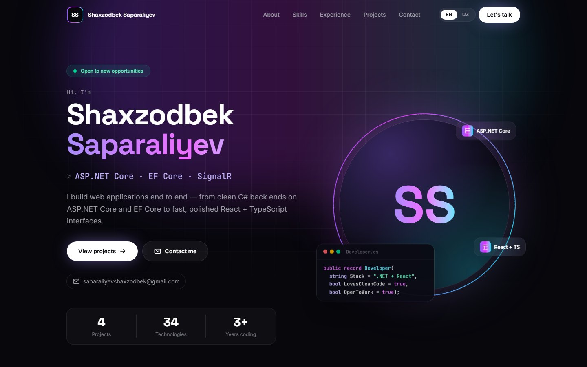
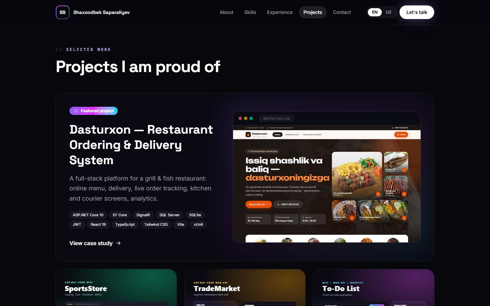
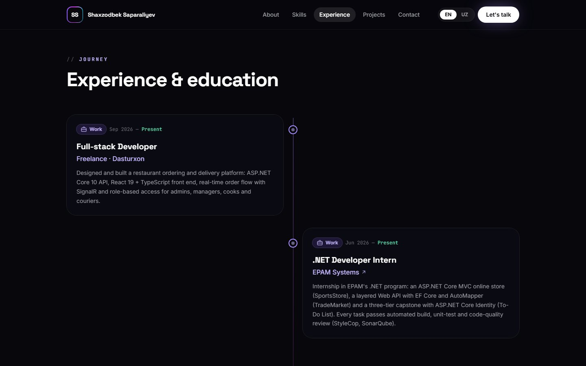
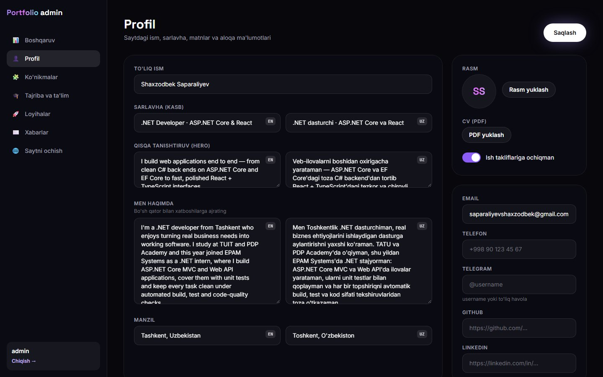
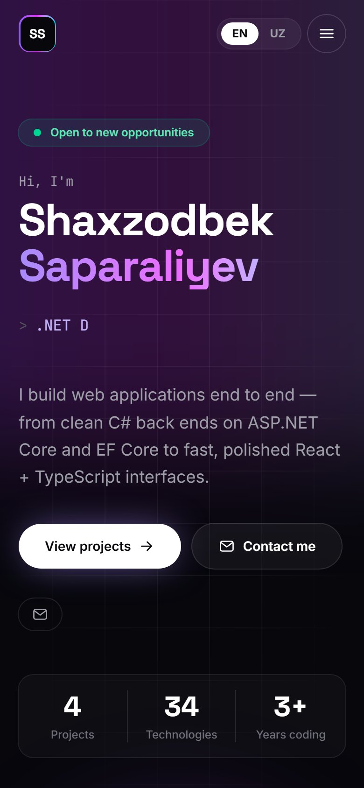

# Shaxzodbek Saparaliyev — portfolio / CV sayt

Shaxsiy CV sayt: backend (ASP.NET Core 10 + EF Core) va frontend (React + TypeScript + Tailwind), ingliz va o'zbek tillarida,
ma'lumotlarni tahrirlash uchun admin panel bilan.

**Stack:** ASP.NET Core 10 · EF Core · SQLite · JWT · React 19 · TypeScript · Tailwind CSS · Vite · xUnit



| Loyihalar | Tajriba va ta'lim |
|---|---|
|  |  |
| **Admin panel** | **Telefon** |
|  |  |

## Ishga tushirish

| Yo'l | Nima qilinadi |
|---|---|
| **Eng oson** | `Ishga-tushirish.bat` ni ikki marta bosing — brauzer o'zi ochiladi. |
| **Visual Studio** | `Portfolio.sln` → **F5** (profil: *Sayt + API*). |
| **VS Code** | Loyiha papkasini oching → **F5**. |

| Manzil | Nima |
|---|---|
| http://localhost:5174 | Sayt |
| http://localhost:5174/admin | Admin panel |
| http://localhost:5021/swagger | API hujjatlari (faqat Development) |

Admin kirish ma'lumotlari (faqat lokal ishlab chiqish uchun) `src/Portfolio.WebApi/appsettings.Development.json` faylida.
Serverga chiqarishda boshqa parol qo'yiladi (pastga qarang).

## Saytda nima bor

- **Hero:** ism, kasb (yozuv mashinkasi effekti), qisqa tanishtiruv, CV yuklab olish, ijtimoiy tarmoqlar, statistika.
- **Men haqimda**, **Ko'nikmalar** (Backend, Frontend, Database, Tools), **Tajriba va ta'lim** (vaqt chizig'i).
- **Loyihalar:** Dasturxon (asosiy, 8 ta skrinshot bilan), SportsStore, TradeMarket, To-Do List — har birining alohida sahifasi va galereyasi.
- **Aloqa formasi:** xabar bazaga yoziladi, admin panelda ko'rinadi (spam-tuzoq va so'rovlar cheklovi bor).
- **EN / UZ** tugmasi, telefon va kompyuterga moslashgan, animatsiyalar.

## Admin panel

- **Profil:** ism, sarlavha, matnlar (ikki tilda), rasm, CV (PDF), telefon, Telegram, GitHub, LinkedIn.
- **Ko'nikmalar**, **Tajriba va ta'lim**, **Loyihalar** (rasm yuklash, galereya, havolalar) — qo'shish, tahrirlash, o'chirish.
- **Xabarlar** va **tashriflar statistikasi**.

> Tajriba bo'limidagi oylar taxminiy qo'yilgan — admin paneldan aniqlab qo'ying. Rasm, CV PDF, telefon, Telegram,
> GitHub va LinkedIn ham admin paneldan qo'shiladi.

## Tuzilishi

```
C:\Shaxzod_cv
├── Portfolio.sln              ← Visual Studio
├── Ishga-tushirish.bat        ← bir bosishda ishga tushirish
├── Publish.bat                ← serverga yuklanadigan "publish" papkasi
├── src
│   ├── Portfolio.Data         ← EF Core: jadvallar (ikki tilli matnlar), migratsiyalar
│   ├── Portfolio.Business     ← servislar, DTO, boshlang'ich ma'lumotlar
│   ├── Portfolio.WebApi       ← API, JWT, fayl yuklash, tashriflar hisobi
│   └── Portfolio.Web          ← React + TypeScript + Tailwind (sayt va admin panel)
└── tests\Portfolio.Tests      ← xUnit testlar
```

Ma'lumotlar bazasi bitta fayl: `src/Portfolio.WebApi/App_Data/portfolio.db` (SQLite). Yuklangan rasmlar: `wwwroot/uploads`.

## Serverga joylash

1. `Publish.bat` → `C:\Shaxzod_cv\publish` papkasi tayyor bo'ladi (sayt + API bitta joyda).
2. `publish\appsettings.Production.json` da `Jwt:Key` (kamida 32 belgili tasodifiy kalit) va `Admin:Password` ni o'zgartiring —
   o'zgartirilmasa ilova ishga tushmaydi.
3. Papkani serverga ko'chiring (Windows + IIS: ASP.NET Core Hosting Bundle; Linux: `dotnet Portfolio.WebApi.dll` + nginx).
